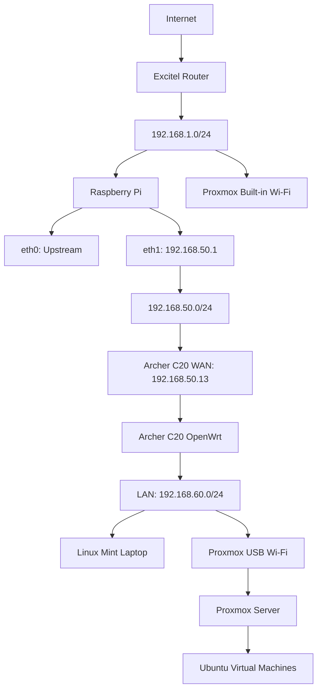

# Home Lab network Connectivity

## Overview

This project documents the design, implementation, and troubleshooting of a multi-network home lab environment.

The objective is to connect multiple network segments using an ISP-provided Excitel router, a Raspberry Pi gateway, a TP-Link Archer C20 router running OpenWrt, and a Proxmox virtualization server.

The project also explores multi-interface connectivity on Linux systems to improve access to home lab resources without repeatedly switching between wireless networks.

It combines two main objectives:

1. Establish connectivity between the Excitel network, Raspberry Pi gateway, and Archer C20 home lab network.
2. Enable access to Proxmox and other home lab devices through multiple network interfaces.

This is a practical networking project involving IP addressing, routing, DHCP, wireless connectivity, and Linux network troubleshooting.

## Project Objectives

- Connect multiple independent private network segments.
- Use Raspberry Pi as an intermediary gateway.
- Configure TP-Link Archer C20 with OpenWrt.
- Establish a dedicated network between the Raspberry Pi and Archer C20.
- Provide a separate LAN for home lab devices.
- Enable multiple network connections on Proxmox.
- Improve access to Proxmox from different network segments.
- Investigate Linux routing and network interface metrics.
- Improve local file-transfer connectivity.
- Reduce the need to switch wireless networks when accessing home lab resources.

## Hardware and Software

| Component | Hardware / Software |
|---|---|
| ISP Router | Excitel-provided router |
| Gateway | Raspberry Pi |
| Downstream Router | TP-Link Archer C20 v4 |
| Router Firmware | OpenWrt 19.07.10 |
| Virtualization Server | Proxmox VE |
| Client Laptop | Lenovo ThinkPad T480 |
| Gateway OS | Raspberry Pi OS |
| Proxmox OS | Proxmox VE |
| Client OS | Linux Mint |
| Network Services | DHCP, DNS, IP Routing |

## Network Architecture

The environment contains three primary network segments.

### 1. Excitel Network

The Excitel router provides the primary internet connection.

| Parameter | Configuration |
|---|---|
| Network | 192.168.1.0/24 |
| Raspberry Pi interface | eth0 |
| Raspberry Pi IP | 192.168.1.4 |
| Proxmox interface | wlp3s0 |
| Proxmox IP | 192.168.1.91 |

### 2. Raspberry Pi Gateway Network

The Raspberry Pi connects the upstream network to the downstream Archer C20 router.

| Parameter | Configuration |
|---|---|
| Device | Raspberry Pi |
| Interface | eth1 |
| IP address | 192.168.50.1/24 |
| DHCP service | dnsmasq |
| Connected router | Archer C20 WAN |

### 3. Archer C20 Home Lab Network

The Archer C20 provides a separate wireless LAN for home lab clients.

| Parameter | Configuration |
|---|---|
| Device | TP-Link Archer C20 v4 |
| Firmware | OpenWrt 19.07.10 |
| WAN IP | 192.168.50.13 |
| LAN IP | 192.168.60.1 |
| LAN subnet | 192.168.60.0/24 |
| DHCP range | 192.168.60.100–192.168.60.199 |
| Wireless bands | 2.4 GHz and 5 GHz |

## Network Topology



The Proxmox server has two wireless interfaces that were tested for connectivity to both networks.

## Raspberry Pi Gateway Configuration

The Raspberry Pi uses separate Ethernet interfaces for upstream and downstream connectivity.

| Interface | Purpose | Address |
|---|---|---|
| eth0 | Upstream Excitel connection | DHCP assigned |
| eth1 | Downstream Archer connection | 192.168.50.1/24 |

The downstream Ethernet interface is configured with a static IP address.

```text
192.168.50.1/24
```

dnsmasq is used for DHCP services on the downstream network.

The Raspberry Pi gateway is also used in a separate VPN gateway project. VPN routing and firewall configurations are documented separately.

## Archer C20 OpenWrt Configuration

The TP-Link Archer C20 v4 was configured with OpenWrt 19.07.10.

The router connects to the Raspberry Pi through its WAN interface and provides a separate LAN for home lab clients.

### WAN Configuration

```text
WAN Network: 192.168.50.0/24
WAN Address: 192.168.50.13
Upstream Gateway: Raspberry Pi
```

### LAN Configuration

```text
LAN Address: 192.168.60.1
Subnet: 192.168.60.0/24
DHCP Start: 192.168.60.100
DHCP End: 192.168.60.199
```

### Wireless Configuration

Two wireless networks were configured:

- C20-Open-2.4G
- C20-Open-5G

Both bands provide wireless access to the home lab network.

## Proxmox Multi-network Connectivity

One of the important parts of this project was improving connectivity to the Proxmox server.

Initially, Proxmox was connected to the Excitel network using its built-in wireless adapter.

To provide an additional connection to the Archer C20 network, a USB Wi-Fi adapter was introduced.

### Network Interfaces

| Interface | Purpose | Network |
|---|---|---|
| wlp3s0 | Built-in Wi-Fi | Excitel |
| wlx3460f935e220 | USB Wi-Fi | Archer C20 |

The USB Wi-Fi adapter was configured and tested against the Archer C20 network.

The Proxmox server was assigned an address in the Archer C20 subnet during testing.

This setup allowed the server to maintain connectivity through its original wireless interface while testing a second connection to the home lab network.

### Connectivity Testing

The Archer C20 gateway was tested through the USB wireless interface.

Example:

```bash
ping -I wlx3460f935e220 192.168.60.1
```

The test successfully established connectivity with the Archer C20 gateway.

The Proxmox server and Linux Mint laptop were also tested for direct connectivity through the Archer C20 network.

Some connectivity problems were observed initially and were investigated after restarting the Proxmox server.

The setup demonstrated that multiple wireless interfaces could be used to connect the Proxmox host to separate network segments.

## Linux Network Routing and Troubleshooting

Multiple network interfaces introduce additional routing considerations.

During implementation, Linux route selection and interface metrics were investigated to understand which interface was being used for outgoing traffic.

### Useful Diagnostic Commands

**1. List network interfaces**

```bash
ip addr show
```

**2. Check routing table**

```bash
ip route show
```

**3. Check routing rules**

```bash
ip rule show
```

**4. Identify route selection**

```bash
ip route get 8.8.8.8
```

**5. Test a specific interface**

```bash
ping -I <interface-name> <destination-ip>
```

**6. Check wireless connection**

```bash
iw dev
```

**7. Check wireless signal**

```bash
iw dev <interface-name> link
```

**8. Check interface status**

```bash
ip link show
```

## Local Network Performance Investigation

Another objective was to improve file-transfer performance between Linux Mint and Proxmox.

The investigation included:

- Checking wireless signal strength.
- Testing connectivity through the Archer C20.
- Comparing built-in and USB Wi-Fi interfaces.
- Investigating packet loss.
- Checking interface-specific routing.
- Testing connectivity after restarting network services and Proxmox.

The goal is to improve communication between home lab devices without requiring manual network switching.

Performance optimization and long-term routing stability remain areas for further testing.

## Implementation Results

The following configurations and tests have been completed:

| Component | Result |
|---|---|
| Raspberry Pi upstream connection | Configured |
| Raspberry Pi downstream interface | Configured |
| Raspberry Pi DHCP service | Configured |
| Archer C20 OpenWrt | Configured |
| Archer C20 WAN connectivity to Pi | Established |
| Archer C20 LAN subnet | Configured |
| Wireless connectivity | Tested |
| Proxmox built-in Wi-Fi | Operational |
| Proxmox USB Wi-Fi | Connected and tested |
| Connectivity to Archer gateway via USB Wi-Fi | Successfully tested |
| Proxmox and Linux Mint connectivity | Tested |
| Multi-interface routing | Investigated |
| Local file-transfer optimization | Further testing required |

The above results describe the tested lab configuration. They do not imply that all devices have unrestricted, persistent connectivity across every subnet.

## Future Improvements

- Validate persistent routing between the three network segments.
- Configure predictable interface-specific routing.
- Improve seamless access to Proxmox from the primary network.
- Optimize local file-transfer performance.
- Investigate wireless packet loss and signal quality.
- Implement automated network recovery.
- Evaluate whether static routing or other network architecture changes are needed.
- Integrate network status checks into the Home Lab Monitoring Dashboard.
- Document end-to-end connectivity tests.

## Security Considerations

This repository is intended for public GitHub publication.

Before publishing configuration files and scripts, remove:

- Router administrator credentials.
- Wi-Fi passwords.
- ISP account information.
- SSH private keys.
- VPN private keys and credentials.
- Authentication tokens.
- Public IP addresses associated with the home connection.

Private IP addresses in this README are used to explain the lab architecture. They can be changed to documentation-only example ranges if desired.

Do not publish complete router backups or unreviewed firewall configuration files.

## Suggested Repository Structure

```text
home-lab-network-connectivity/
│
├── README.md
│
├── documentation/
│   ├── network-architecture.md
│   ├── ip-addressing.md
│   ├── raspberry-pi-gateway.md
│   ├── openwrt-router.md
│   ├── proxmox-connectivity.md
│   ├── routing.md
│   └── troubleshooting.md
│
├── diagrams/
│   └── network-topology.md
│
├── scripts/
│   └── README.md
│
└── screenshots/
    └── README.md
```

## Learning Outcomes

This project provides hands-on experience with:

- Multi-subnet network architecture.
- Linux network administration.
- IP addressing and routing.
- DHCP and DNS services.
- Raspberry Pi gateway configuration.
- OpenWrt router administration.
- Multiple wireless interfaces.
- Proxmox networking.
- Linux routing tables and interface metrics.
- Network connectivity troubleshooting.
- Home lab infrastructure design.

## Disclaimer

This is a personal home lab project intended for learning, experimentation, and research.

The configuration is based on a privately maintained home network. Hardware, firmware, and network topology may change over time.

## Author

Personal Home Lab – Networking and Infrastructure

**Technologies:** Linux, Raspberry Pi, Proxmox VE, OpenWrt, TP-Link Archer C20, DHCP, DNS, IP Routing, Wi-Fi.
