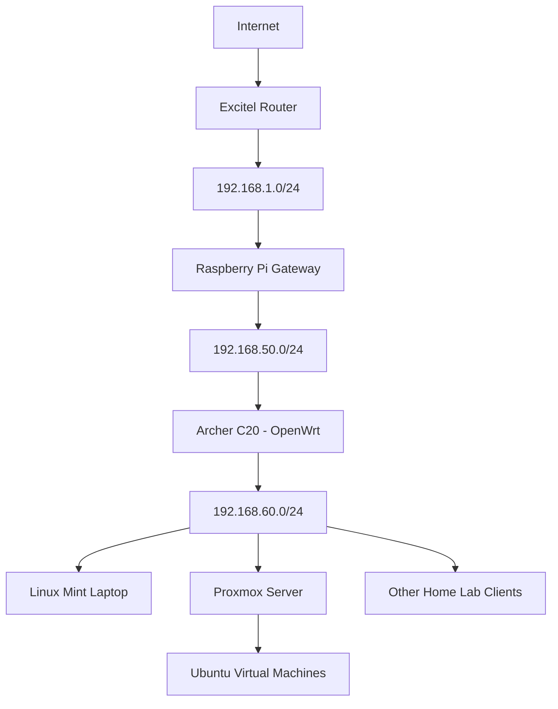

# Home Lab network Connectivity

## Overview

This project documents the design, configuration, and troubleshooting of a multi-network home lab environment.

The objective is to establish connectivity between multiple isolated network segments using different routers and Linux-based infrastructure.

The environment consists of an ISP-provided Excitel router, a Raspberry Pi gateway, a TP-Link Archer C20 router running OpenWrt, and several Linux-based home lab machines.

An important goal of this project is to make home lab resources accessible across different network segments without requiring users to manually switch between Wi-Fi networks.

The project also explores multiple network interfaces, routing behaviour, and connectivity between Proxmox and Linux client machines.

## Project Objectives

- Establish multiple independent home network segments.
- Connect downstream networks through a Raspberry Pi gateway.
- Configure a TP-Link Archer C20 router with OpenWrt.
- Understand routing between different private IP subnets.
- Enable access to home lab machines across network segments.
- Reduce the need to switch Wi-Fi networks when accessing Proxmox.
- Experiment with multiple network interfaces on Linux machines.
- Diagnose connectivity, routing, and packet-loss issues.

## Network Architecture

The home lab uses three primary network segments.

### 1. Upstream Network – Excitel

The Excitel router provides the primary internet connection.

| Component | Configuration |
|---|---|
| Router | Excitel ISP router |
| Network | 192.168.1.0/24 |
| Raspberry Pi interface | eth0 |
| Raspberry Pi address | DHCP assigned |

### 2. Gateway Network – Raspberry Pi

The Raspberry Pi acts as an intermediary between the upstream network and the downstream Archer C20 router.

| Component | Configuration |
|---|---|
| Device | Raspberry Pi |
| Interface | eth1 |
| IP address | 192.168.50.1/24 |
| DHCP service | dnsmasq |
| Downstream router | TP-Link Archer C20 |

### 3. Home Lab Network – Archer C20

The Archer C20 operates using OpenWrt firmware and provides connectivity to downstream wireless clients.

| Component | Configuration |
|---|---|
| Router | TP-Link Archer C20 v4 |
| Firmware | OpenWrt 19.07.10 |
| Router LAN address | 192.168.60.1 |
| LAN network | 192.168.60.0/24 |
| DHCP range | 192.168.60.100–192.168.60.199 |
| WAN address | 192.168.50.13 |
| Wireless bands | 2.4 GHz and 5 GHz |

## Network Topology



## Network Configuration

### Raspberry Pi Gateway

The Raspberry Pi uses separate network interfaces for upstream and downstream connectivity.

The relevant interface roles are:

| Interface | Role |
|---|---|
| eth0 | Upstream connection to Excitel |
| eth1 | Downstream connection to Archer C20 |
| wlan0 | Additional wireless connectivity |

The downstream Ethernet interface uses a static address:

```text
192.168.50.1/24
```

The Raspberry Pi also uses dnsmasq for DHCP services on the downstream gateway network.

### Archer C20 – OpenWrt

The TP-Link Archer C20 v4 was configured with OpenWrt firmware.

The WAN interface connects to the Raspberry Pi gateway network.

The LAN interface provides a separate subnet for home lab devices.

The router provides wireless connectivity through two SSIDs:

- C20-Open-2.4G
- C20-Open-5G

The objective is to keep devices connected to the Archer C20 within the dedicated home lab subnet while using the Raspberry Pi as the upstream gateway.

## Proxmox Multi-network Connectivity

An additional part of this project involved improving access to the Proxmox server.

The Proxmox host originally used its built-in wireless interface to connect to the Excitel network.

A USB Wi-Fi adapter was also introduced to connect the machine to the Archer C20 network.

The interfaces tested included:

| Interface | Purpose |
|---|---|
| wlp3s0 | Built-in Wi-Fi – Excitel network |
| wlx3460f935e220 | USB Wi-Fi adapter – Archer C20 network |

The USB Wi-Fi interface was tested with a dedicated network address in the Archer C20 subnet.

This allowed direct connectivity testing between Proxmox and other devices connected to the Archer C20.

## Connectivity and Routing Troubleshooting

During implementation, several network-related problems were investigated.

### 1. Different Network Segments

Devices connected to the Excitel router and Archer C20 were operating in different IP subnets.

The objective was to provide access to required home lab services without manually changing Wi-Fi connections.

### 2. Linux Routing Behaviour

The Proxmox server had multiple network interfaces.

Linux route selection and interface metrics affected which network interface was used for outgoing traffic.

Interface-specific connectivity tests were performed to identify routing issues.

Example:

```bash
ip addr
ip route
ip rule
```

### 3. Interface-specific Connectivity Testing

The USB Wi-Fi adapter was tested independently.

Example:

```bash
ping -I wlx3460f935e220 192.168.60.1
```

This was used to verify that the USB Wi-Fi interface could communicate with the Archer C20 router.

### 4. Wi-Fi Signal and Packet Loss

Signal strength and connectivity were investigated on both built-in and USB wireless interfaces.

Useful diagnostic commands:

```bash
iw dev
```

```bash
iwconfig
```

```bash
ip link
```

Connectivity was tested using:

```bash
ping -c 10 192.168.60.1
```

### 5. Network Restart and Connectivity Recovery

Connectivity between Proxmox and the Linux Mint client was also tested after network interface changes and a Proxmox restart.

The troubleshooting helped identify problems related to interface state, routing, and connectivity recovery.

## Useful Linux Networking Commands

### Check Network Interfaces

```bash
ip addr show
```

### Check Routing Table

```bash
ip route show
```

### Check Routing Rules

```bash
ip rule show
```

### Check Default Gateway

```bash
ip route get 8.8.8.8
```

### Test a Specific Network Interface

```bash
ping -I <interface-name> <destination-ip>
```

### Test Network Connectivity

```bash
ping <destination-ip>
```

### Check Wi-Fi Signal Information

```bash
iw dev <interface-name> link
```

## Results and Current State

The following areas have been configured or tested:

- Raspberry Pi gateway with separate upstream and downstream interfaces.
- Dedicated network segment between the Raspberry Pi and Archer C20.
- Archer C20 running OpenWrt.
- Separate home lab LAN subnet.
- DHCP configuration on the downstream network.
- Proxmox connectivity through the Archer C20.
- USB Wi-Fi adapter connectivity testing.
- Investigation of multi-interface routing and network metrics.
- Connectivity testing between Proxmox and Linux Mint.

Some aspects of seamless inter-subnet routing and automatic interface selection still require additional validation.

## Security Considerations

This repository is intended for public GitHub publication.

Do not commit:

- Actual Wi-Fi passwords.
- Router administrator credentials.
- VPN private keys.
- ISP account information.
- SSH private keys.
- Sensitive firewall configurations.
- Unnecessary device identifiers or personal network information.

Private IP ranges in this documentation are included to explain the architecture. Actual device-specific configurations should be reviewed and sanitized before publication.

## Future Improvements

- Implement predictable routing between required network segments.
- Configure and validate persistent route policies.
- Improve seamless access to Proxmox from the primary network.
- Optimize local file-transfer performance.
- Improve wireless connectivity and reduce packet loss.
- Configure automatic interface failover where appropriate.
- Add network monitoring to the home lab dashboard.
- Document network recovery and troubleshooting procedures.

## Suggested Repository Structure

```text
home-lab-network-connectivity/
│
├── README.md
│
├── documentation/
│   ├── network-architecture.md
│   ├── ip-addressing.md
│   ├── routing.md
│   └── troubleshooting.md
│
├── diagrams/
│   └── network-topology.md
│
├── scripts/
│   └── README.md
│
└── screenshots/
    └── README.md
```

## Learning Outcomes

This project demonstrates hands-on experience with:

- Linux networking.
- Multi-subnet network architecture.
- Network routing and interface metrics.
- Raspberry Pi gateway configuration.
- OpenWrt router administration.
- DHCP and IP addressing.
- Multi-interface connectivity.
- Proxmox network configuration.
- Wireless network troubleshooting.

## Disclaimer

This is a personal home lab project intended for learning, experimentation, and research.

Configurations and network topology may evolve as additional devices and services are integrated.

## Author

Personal Home Lab – Networking and Infrastructure

**Technologies:** Linux, Raspberry Pi, Proxmox VE, OpenWrt, TP-Link Archer C20, DHCP, DNS, IP Routing, Wi-Fi.
